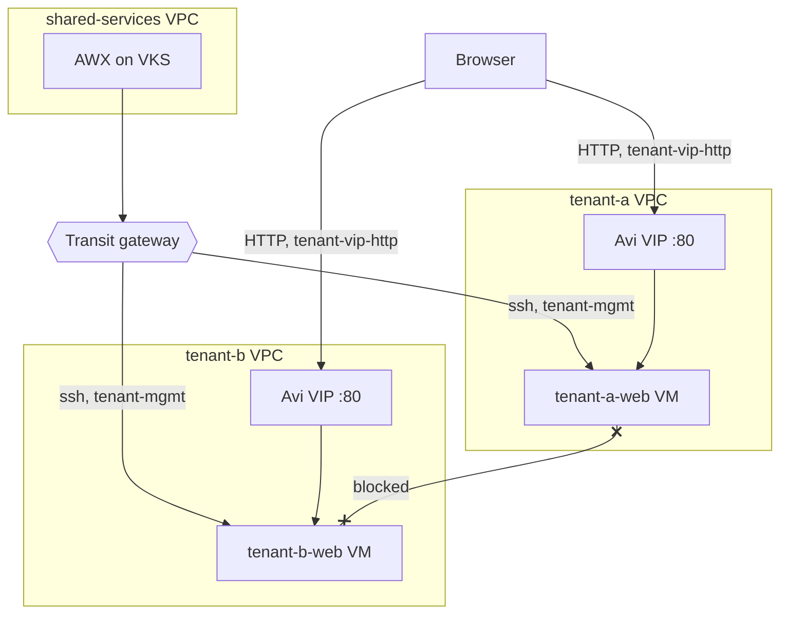
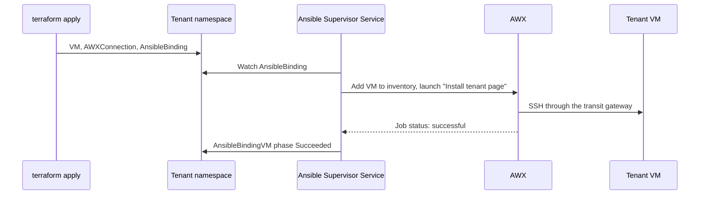

# Architecture

## Network

Every arrow points the way traffic flows. Each label names the protocol and the org firewall policy that allows it.

## Configuring a VM

`terraform apply` creates the tenant. The Ansible Supervisor Service then runs the AWX job that installs the page.

## Isolation

Each tenant VPC gets the built-in *VPC External Connectivity* security profile, which allows outbound traffic and denies inbound and VPC-to-VPC traffic. Three org-level Infrastructure firewall policies in `tenants/isolation.tf` sit in front of it and let three things back in:

- AWX, matched as the shared-services VPC object rather than an IP
- internet egress
- HTTP to the load balancer VIPs

Traffic from one tenant to the other matches none of them. The policies need vDefend (NSX distributed firewall). All of it is org scope, so an Organization Administrator can create it.

AWX reaches the tenant VMs because its cluster nodes sit on a PrivateTGW subnet. Traffic from them crosses the transit gateway without SNAT, so the tenant firewall can allow "the shared-services VPC" as an object instead of an IP.

## Gotchas

- **Image names must be unique in the org.** VM Operator refuses an image name that matches more than one image visible to a namespace, and any library in the org can add one. The image is named `tenant-demo-ubuntu-24.04` for that reason.
- **The guest LoadBalancer status can stall after a node rollout.** The likely cause: when the cloud provider starts while no worker is ready, it ensures the load balancer with no backends, and the service's address stays empty after the worker joins. A restart of the cloud provider writes it.
- **NSX purges deleted VPC names after up to 5 minutes.** Recreating a tenant before then fails with `is marked for deletion`.
- **NSX refuses to delete a subnet while a VM's subnet port remains.** The tenant VM resource waits for its delete to finish before Terraform deletes the subnet.
- **Helm 4 hangs on HTTP/2 to the cluster's load-balanced API address.** `awx.sh` sets `DISABLE_HTTP2=true`.
