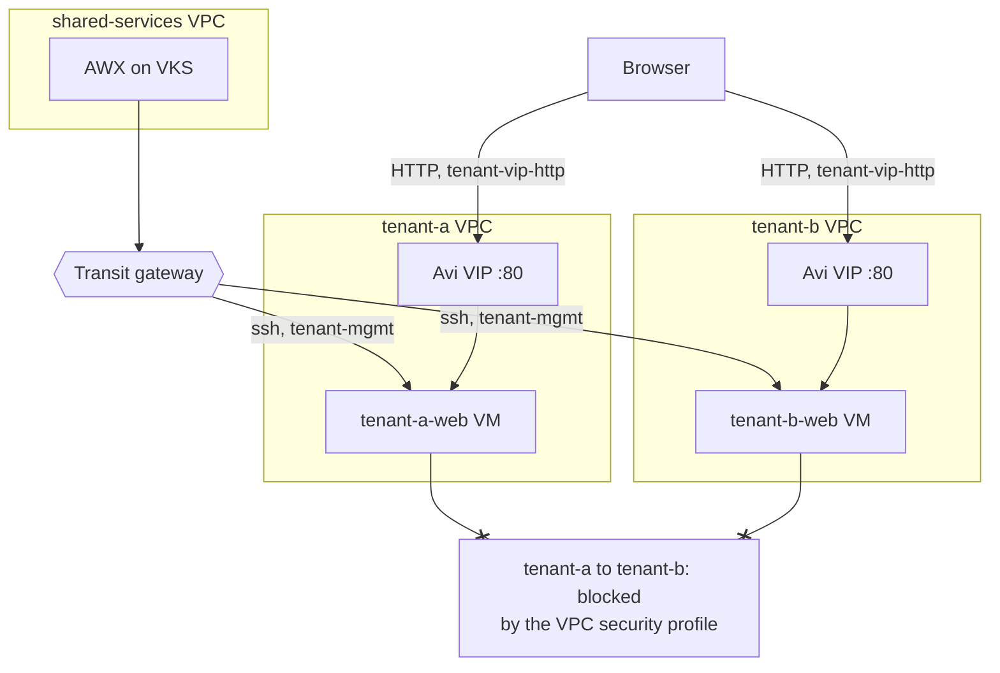
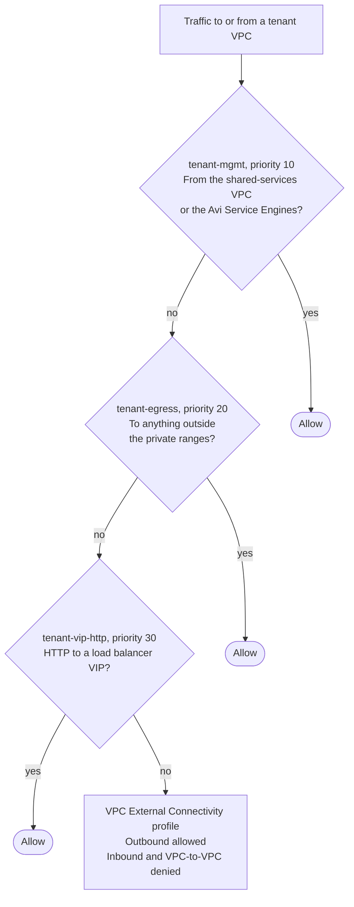

# Architecture

## Network

Every arrow points the way traffic flows. Each label names the protocol and the org firewall policy that allows it.

## Firewall design

All of it is org scope, in `tenants/isolation.tf`, so an Organization Administrator can create it. It needs vDefend (NSX distributed firewall).

Each tenant VPC gets the built-in *VPC External Connectivity* security profile: outbound allowed, inbound and VPC-to-VPC denied. On its own that profile also breaks three things the demo needs, so three Infrastructure firewall policies, evaluated before it, put them back. Tenant to tenant matches none of them, so the profile drops it.

### Network security groups

| Group | Members | Used by |
|---|---|---|
| `tenant-vpcs` | The tenant VPCs, by name | Applied-to of all three policies |
| `tenant-mgmt-shared-services` | The shared-services VPC, by name | `tenant-mgmt` source |
| `tenant-mgmt-avi` | `100.64.0.0/10`, the Avi Service Engine range | `tenant-mgmt` source |
| `tenant-private-ranges` | `10.0.0.0/8`, `172.16.0.0/12`, `192.168.0.0/16`, `100.64.0.0/10` | `tenant-egress` destination, excluded |
| `tenant-lb-vips` | `TF_VAR_vip_range` from `.env` | `tenant-vip-http` destination |

A group with VPC members cannot also hold IPs, so the shared-services VPC and the Avi range are two groups.

### Firewall policies

| Policy | Priority | Direction | From | To | Service |
|---|---|---|---|---|---|
| `tenant-mgmt` | 10 | In | `tenant-mgmt-shared-services`, `tenant-mgmt-avi` | Any | Any |
| `tenant-egress` | 20 | InOut | Any | Not `tenant-private-ranges` | Any |
| `tenant-vip-http` | 30 | InOut | Any | `tenant-lb-vips` | HTTP |

All three are stateful, in the Infrastructure category, and applied to `tenant-vpcs`.

### Why it is shaped this way

- **AWX is matched as a VPC, not an IP.** The AWX cluster nodes sit on a PrivateTGW subnet. Traffic from them crosses the transit gateway without SNAT, so the tenant firewall sees the shared-services VPC as the source and can allow it as an object.
- **Egress needs its own allow.** The profile's deny also sits on the VPC's own service gateway ports, where the packet arrives already SNATed, so "allow out" from the VM is not enough. `tenant-egress` allows any source to anything outside the private ranges, which never includes the other tenant.
- **The VIPs need their own allow.** The Avi Service Engine NICs sit inside the tenant VPC, so HTTP to a VIP is inbound traffic that the profile would drop.

## Gotchas

- **Image names must be unique in the org.** VM Operator refuses an image name that matches more than one image visible to a namespace, and any library in the org can add one. The image is named `tenant-demo-ubuntu-24.04` for that reason.
- **The guest LoadBalancer status can stall after a node rollout.** The likely cause: when the cloud provider starts while no worker is ready, it ensures the load balancer with no backends, and the service's address stays empty after the worker joins. A restart of the cloud provider writes it.
- **NSX purges deleted VPC names after up to 5 minutes.** Recreating a tenant before then fails with `is marked for deletion`.
- **NSX refuses to delete a subnet while a VM's subnet port remains.** The tenant VM resource waits for its delete to finish before Terraform deletes the subnet.
- **Helm 4 hangs on HTTP/2 to the cluster's load-balanced API address.** `awx.sh` sets `DISABLE_HTTP2=true`.
